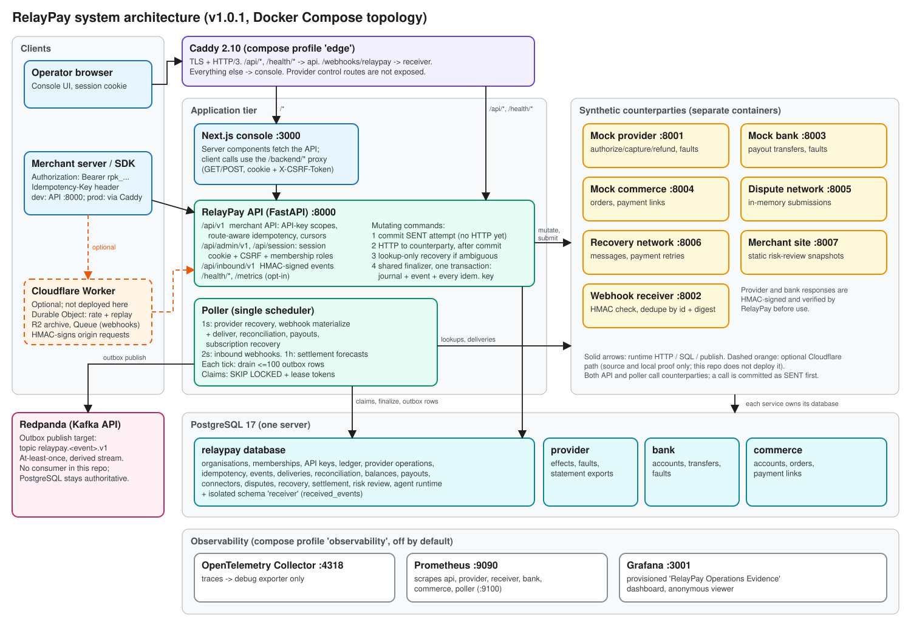

# Architecture



Editable source: [architecture.excalidraw](diagrams/architecture.excalidraw).

## Runtime components

All Python services are built from one image (`Dockerfile.python`) and differ only by command.
Ports are the container ports from `compose.yaml`.

| Service | Port | Responsibility |
| --- | ---: | --- |
| `api` | 8000 | Merchant API, admin API, session login, inbound webhooks, health, opt-in `/metrics` |
| `poller` | 9100 (metrics) | Single scheduler for every background batch (below) |
| `console` | 3000 | Next.js operator UI; proxies browser calls to the API |
| `provider` | 8001 | Mock payment provider: effects keyed by stable key, one-shot faults, statement export |
| `receiver` | 8002 | Reference webhook consumer; verifies the signature and deduplicates |
| `bank` | 8003 | Mock bank used for payouts |
| `commerce` | 8004 | Mock commerce store (orders, payment links) |
| `dispute-network` | 8005 | Mock dispute network; holds submissions in memory |
| `recovery-network` | 8006 | Mock message and recurring-payment-retry network |
| `merchant-site` | 8007 | Serves static synthetic site snapshots for risk review |
| `postgres` | 5432 | PostgreSQL 17; published on 55432 in development |
| `redpanda` | 9092 / 19092 | Kafka API; target of the business-event outbox |
| `caddy` | 80, 443 | Profile `edge`. TLS; routes `/api/*` and `/health/*` to the API, `/webhooks/relaypay` to the receiver, the rest to the console |
| `migrate` | none | One-shot: Alembic upgrade for all five trees, then `scripts.seed` |

`otel-collector`, `prometheus`, and `grafana` run under the `observability` profile. The
Cloudflare Worker in `apps/edge` is not part of the compose topology; see
[operations/cloudflare-edge.md](operations/cloudflare-edge.md).

### Poller schedule

`apps/worker/poller.py` runs one loop. A task is skipped until its interval has elapsed, and the
loop sleeps one second between ticks.

| Task | Interval | Module |
| --- | ---: | --- |
| Provider recovery (status lookups) | 1 s | `provider_operations/recovery.py` |
| Webhook delivery materialization | 1 s | `event_delivery/materializer.py` |
| Webhook delivery | 1 s | `event_delivery/delivery.py` |
| Reconciliation runs | 1 s | `reconciliation/service.py` |
| Payout attempts | 1 s | `payouts/service.py` |
| Subscription recovery actions | 1 s | `subscriptions/execution.py` |
| Inbound webhooks (commerce sync) | 2 s | `connectors/service.py` |
| Settlement forecasts | 3600 s | `settlement_intelligence/execution.py` |

Every tick also drains up to 100 business-event outbox rows to Redpanda. "Single scheduler" is a
deployment convention: nothing enforces it with a lock. A second poller is safe because every claim
uses `FOR UPDATE SKIP LOCKED` and a lease token, but that is not a tested scale-out configuration.
Dispute submissions have no poller task; an ambiguous submission is recovered when an operator
re-submits the package.

## Reliability boundary

PostgreSQL is the only correctness authority. A command locks the payment, attaches an
idempotency record, commits a provider operation with a `SENT` attempt, and only then performs
HTTP. The operation's own status stays `PROCESSING` (`SENT` is the attempt state). Evidence from
the provider is validated before the shared finalizer may act on it.

```mermaid
sequenceDiagram
    participant M as Merchant / console
    participant A as RelayPay API
    participant D as RelayPay PostgreSQL
    participant P as Mock provider
    participant W as Poller
    participant R as Receiver

    M->>A: POST capture (Idempotency-Key A)
    A->>D: Lock payment; attach key A; commit operation + SENT attempt
    A->>P: POST /v1/effects (stable provider key)
    P->>P: Commit one capture effect
    P--xA: Response lost (synthetic 599 or timeout)
    A->>D: Record ambiguous attempt; next_lookup_at = now
    A-->>M: 202 operation PROCESSING
    W->>D: Claim lookup lease (SKIP LOCKED, 30 s)
    W->>P: GET /v1/effects/{stable key} (no mutation)
    P-->>W: Reply signed with provider secret
    W->>W: Verify signature, schema, identity tuple
    W->>D: Finalizer: capture + journal + event + terminal bytes for every key
    W->>D: Materialize recipient delivery
    W->>R: POST event bytes, HMAC v1 signature
    R->>R: Deduplicate by event id + digest
    R-->>W: 200
    W->>D: Record immutable attempt; mark DELIVERED
```

What "signed lookup" means here: the lookup request carries only the stable key and account id.
The signature is on the provider's response, which RelayPay verifies with
`PROVIDER_SIGNING_SECRET` before checking the exact account, key, kind, reference, amount, and
currency.

Lookup outcomes: a verified success finalizes; a verified decline finalizes the capture as
`FAILED` with no journal or event; a verified pending reply, a 5xx, or a transport error keeps the
operation `PROCESSING` with backoff (`min(2^(n-2), 60)` seconds). After five lookups that remain
indeterminate, or on invalid evidence (bad signature, schema, or mismatched identity), the
operation moves to `REQUIRES_REVIEW`. An operator can then trigger one more lookup
(`POST /api/v1/operations/{id}/retry_lookup`); the mutation is never resent.

Other sections of the system reuse the same shape: payouts (`PayoutAttempt`), dispute
submissions, and recurring-payment retries each commit a send attempt first and recover by lookup.

## Data ownership

PostgreSQL hosts four databases and one extra schema. Table-level detail is in
[database.md](database.md).

| Store | Owns |
| --- | --- |
| `relaypay` database | Identity, API keys, payments, provider operations and attempts, idempotency records, ledger, merchant events and deliveries, reconciliation, balances, payouts, connectors, disputes, subscription recovery, settlement intelligence, risk review, agent-runtime and outbox tables, request logs |
| `receiver` schema (in `relaypay`) | Verified event ids and digests; reachable only by `receiver_app` |
| `provider` database | Provider accounts, stable-key effects, one-shot fault directives, statement exports |
| `bank` database | Bank accounts, transfer effects, fault directives |
| `commerce` database | Commerce accounts, orders, payment links |
| Redpanda | Derived business-event stream; no authority |
| Browser | No durable authority; the session cookie is HttpOnly and the console stores no credentials |

## Concurrency invariants

Payment lock precedes child/resource locks. A logical command has one provider operation and one
stable key. Refund availability is derived while holding the payment lock. Recovery and delivery
claims use `FOR UPDATE SKIP LOCKED`, opaque lease tokens, expiry, and idempotent finalization.
Reconciliation uses the same claim pattern; source imports serialize on a transaction-scoped
PostgreSQL advisory lock and `(environment, provider, source)` uniqueness.

Merchant balance commands lock the merchant before claiming captures. Balances are reconstructed
from debit/credit postings: capture credits pending payable, settlement debits pending and credits
receivable or available, and refunds debit pending/available or debit receivable. Balance
transactions are immutable journal-keyed projections; they never replace postings as authority.
No network operation occurs inside these accounting transactions.

Payout creation locks the merchant and appends a reservation without posting a journal. Each bank
attempt has a stable numbered key and immutable mutation-send evidence committed before HTTP. Once
sent, workers may only look up that key. Ambiguity retains the reservation (the poller re-selects
`AMBIGUOUS` and `PREPARED` attempts and looks them up); verified decline releases it; verified
success atomically consumes it with one payout journal, balance transaction, terminal response,
history record, and event.

Connector configuration is environment scoped and versioned. Credential ciphertext and digests are
immutable; a pending version is health-verified before explicit activation. Inbound webhook bytes
are authenticated before parsing, stored exactly once, then claimed in short transactions;
commerce synchronization occurs outside the RelayPay transaction against its separately
credentialed database. Connector circuit state is stored and displayed, but traffic is not gated
on it: the payment and bank paths call their transports directly.

## Business events and the agent-runtime tables

Commands that matter to downstream workflows append immutable rows to `business_event_outbox`
inside their PostgreSQL transaction. The poller claims rows under a lease, publishes them to
Redpanda (topic `relaypay.<event type>.v1`, so event types ending in `.v1` produce a doubled
suffix), and records acknowledgement in a second transaction. Publication failures retry with
backoff and have no dead-letter state. Nothing in this repository consumes the topics;
`consumed_business_events` exists for consumers that deduplicate by event id.

The `agent_runtime` package also defines workflow definitions, runs, leased steps, approvals with
maker-checker enforcement, artifacts, prompt and pricing versions, and model-invocation records.
As of 1.0.1 the leased step engine (`workflows.py`) is exercised by tests but is not called by the
API or poller. Production code creates `WorkflowDefinition` and `WorkflowRun` rows directly and
runs each workflow (disputes, recovery, settlement questions, risk review) in its own domain
service; only approval decisions and run reads go through `agent_runtime`.

The "model" roles (settlement intent classification and narrative, risk findings, dispute
drafting) are served by deterministic in-process providers wired in
`apps/api/routes/admin.py`. The `StructuredModelProvider` protocol, `ProviderRouter` fallback, and
the PII-tokenizing, delimiter-based prompt handling exist and are tested, but no vendor transport is
configured for the application. `scripts/compare_live_providers.py` is the only code that contacts
external model APIs, and only when vendor keys are set. See
[ADR-005](adr/005-postgresql-authoritative-agent-runtime.md) and
[ADR-008](adr/008-deterministic-settlement-intelligence.md).

## Public surface

Caddy exposes the console, `/api/*`, `/health/*`, and `/webhooks/relaypay`. PostgreSQL, Redpanda,
provider control routes, `/metrics`, and the other service ports are not published by the
production overlay (`compose.production.yaml` resets them). Without Caddy, development publishes
every service port on the host.

The simulators (provider, bank, dispute, recovery, merchant-site) have no authentication on their
business endpoints and rely on network isolation; only their `/control/*` endpoints require a
shared secret.

## Optional edge

`apps/edge` is a Cloudflare Worker that can front `/api/v1` and inbound connector webhooks: shape
checks, replay and rate admission in a Durable Object, an R2 archive and Queue for webhooks, and an
HMAC signature over each forwarded request. The API verifies that signature only when
`EDGE_ORIGIN_SIGNATURE_REQUIRED=true`. The repository ships it as source with local and CI proof;
nothing deploys it. Compose does not pass the `EDGE_*` variables to containers.
